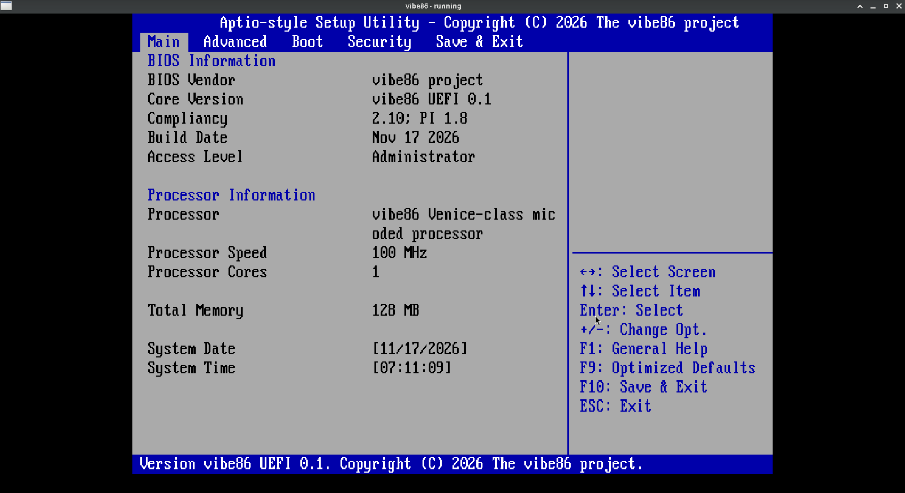

# vibe86



An x86-64 processor in SystemVerilog whose microcode is compiled from the
Intel SDM's pseudocode, with the server board it runs on (Verilator + a C
board model). Target ISA: AMD EPYC "Venice" (Zen 6) — see
[docs/decisions.md](docs/decisions.md) D-007.

| Path | What |
|---|---|
| `rtl/common/` | descriptions every core version shares (D-013): CPUID identity and features, reset state, platform constants, the die's pins; `tools/gen/rtlgen.py` generates their SystemVerilog packages and vsim's C headers into the build tree |
| `rtl/uncore/` | the die's uncore every core version shares (D-014): DDR5 subchannel controllers, the memory init engine (the PSP's role), the address fabric with the I/O link endpoint and the host bridge, the JTAG TAP and debug module |
| `rtl/v1/` | **v1**, the first core: not pipelined, microcoded (`v1_core.sv`, `v1_alu.sv`); `v1_die.sv` the die (core + uncore, the pins of docs/die-interface.md); `tb/` its SystemVerilog testbenches |
| `tools/sdm/` | `extract.py`: the instruction pages of the Intel SDM Vol. 2 as `.sdm` files (generated into the build tree from SDM 325383-093US) |
| `tools/ucc/` | the microcode compiler: SDM pseudocode → micro-ops, decoder tables, entry points; `targets/<vN>/` is one core version's micro-op ISA, instruction list, overrides and routines (`--target`, default the latest) |
| `sim/` | `vsim`: a Verilated die (`-C`, default the latest) on the board model: pin-level DDR5 DIMMs, the I/O die (PCIe + IOMMU, xHCI with a USB floppy, VGA, I2C/TPM, PMC, COM1, the PC legacy devices), a JTAG probe for OpenOCD; see [docs/platform.md](docs/platform.md) |
| `tests/` | programs run from reset on the latest core (`tests/<group>/*.S`, checked by `run.py`) |
| `docs/` | design decisions, the platform, SDM errata found while compiling it |

## Build and test

Needs CMake ≥ 3.24, Ninja or make, Verilator 5, clang + ld.lld, Python 3,
SDL3 and libtpms (vsim).

```
cmake -S . -B build -G Ninja
cmake --build build -j
ctest --test-dir build            # rtl/<latest>/tb testbenches + tests/
build/sim/vsim -n -b test -t build/tests/boot/long-mode.bin   # with an instruction trace
```

The first configure downloads the SDM Vol. 2 (revision 325383-093US,
checked by SHA-256) into the build tree, or takes it from
`-DVIBE86_SDM_PDF=<path>`; Intel's link serves the latest revision, so a
newer manual needs the 093US PDF passed explicitly (or the hash and the
overrides updated together). Nothing generated is kept in the source tree.

The build runs `tools/ucc` for each core version (`build/rtl/v1/gen/`: the
micro-op and microcode packages, a listing `v1.lst`, and `v1-report.md`
saying which pages compiled verbatim and which needed an override).

## How the microcode is made

1. `tools/sdm/extract.py` turns the SDM's instruction pages into opcode
   rows, operand encodings, the Operation pseudocode and the Flags Affected
   prose (D-002, after Reid, FMCAD 2016).
2. `ucc` parses the pseudocode (a lenient parser for the manual's notation)
   and, for every opcode-table row, decode mode and operand kind, partially
   evaluates it: what the row fixes (operand size, where operands live, the
   mode, the instruction's name) folds away, the rest becomes micro-ops
   (D-003). Prose conditions and flag descriptions go through an oracle
   (`oracle.py`) whose rules are the core's architectural assumptions.
3. Where the manual's text can't be compiled as written, an override in
   `targets/<v>/overrides/` replaces that section and says why; the bugs found
   this way are in [docs/sdm-errata.md](docs/sdm-errata.md).
4. Routines with no instruction page are pseudocode too
   (`targets/<v>/routines/`): exception and interrupt delivery (`DELIVER`)
   and the page walk (`WALK`, a micro-trap the TLB takes on a miss).

## Status (v1)

Working, and tested from reset: real mode, 16/32-bit protected mode and
IA-32e mode; segmentation (descriptor loads with their checks, limits,
canonical addresses), rings (far JMP, IRET, interrupt gates with stack
switches, TSS/IST); paging (32-bit, PAE, 4/5-level, A/D bits, U/S, R/W,
NX, SMEP, SMAP) with a TLB and a microcoded walker; the general-purpose
integer instructions, strings with REP, port I/O, MSRs, CPUID; exceptions
and interrupts; interrupt shadows (MOV SS, POP SS, STI).

Not yet: x87, SSE/AVX/AVX-512 (the micro-op format and register selectors
are there; D-009, D-010), far CALL/RET and call/task gates, SYSCALL/SYSRET,
SVM, CET, multiple cores and the LAPIC/IOAPIC, #DF, debug exceptions (TF,
DRn).

## Roadmap

1. C programs and differential tests against the host x86 CPU (Martignoni
   et al., ISSTA 2009).
2. SSE/SSE2 and x87 (third-party UEFI code needs them), then AVX/AVX-512.
3. SMP: two or more cores, LAPIC (xAPIC, timer, INIT/SIPI), IOAPIC.
4. Board: 8254 PIT, 8259 PIC, CMOS RTC, A20, legacy VGA windows (VGA as a PCI
   device), shadow RAM at C0000-FFFFF, DRAM below 4 GiB; xHCI with 4 ports
   and a USB mass-storage floppy.
5. Firmware: a small UEFI (borrowing vercpu's drivers) that boots
   `\EFI\BOOT\BOOTX64.EFI`; goal: CSMWrap → SeaBIOS → MikeOS from a USB floppy.

## References

- Intel 64 and IA-32 Architectures Software Developer's Manual, Vol. 1-4,
  order nos. 253665, 325383 (rev. 093US, Sept. 2026), 325384, 335592.
  https://www.intel.com/sdm
- AMD64 Architecture Programmer's Manual, Vol. 1-5 (pub. 24592-24594, 26568,
  26569). https://www.amd.com/en/support/tech-docs
- A. Reid, "Trustworthy Specifications of ARM v8-A and v8-M System Level
  Architecture", FMCAD 2016. doi:10.1109/FMCAD.2016.7886675
- Y. Futamura, "Partial Evaluation of Computation Process — An Approach to a
  Compiler-Compiler", Systems, Computers, Controls 2(5), 1971; repr. HOSC
  12(4), 1999. doi:10.1023/A:1010095604496
- N. D. Jones, C. K. Gomard, P. Sestoft, *Partial Evaluation and Automatic
  Program Generation*, Prentice Hall, 1993.
- M. V. Wilkes, J. B. Stringer, "Micro-programming and the design of the
  control circuits in an electronic digital computer", Proc. Cambridge
  Philosophical Society 49(2), 1953. doi:10.1017/S0305004100028322
- W. W. Hwu, Y. N. Patt, "Checkpoint Repair for Out-of-order Execution
  Machines", ISCA 1987. doi:10.1145/30350.30352
- S. Heule, E. Schkufza, R. Sharma, A. Aiken, "Stratified Synthesis:
  Automatically Learning the x86-64 Instruction Set", PLDI 2016.
  doi:10.1145/2908080.2908121
- L. Martignoni, R. Paleari, G. Fresi Roglia, D. Bruschi, "Testing CPU
  Emulators", ISSTA 2009. doi:10.1145/1572272.1572303
- S. F. Oberman, M. J. Flynn, "Division Algorithms and Implementations",
  IEEE Trans. Computers 46(8), 1997. doi:10.1109/12.609274
- R. K. Montoye, E. Hokenek, S. L. Runyon, "Design of the IBM RISC System/6000
  floating-point execution unit", IBM J. R&D 34(1), 1990.
  doi:10.1147/rd.341.0059
- R. Allen, K. Kennedy, *Optimizing Compilers for Modern Architectures*,
  Morgan Kaufmann, 2001.
- J. R. Hauser, Berkeley SoftFloat 3e. http://www.jhauser.us/arithmetic/SoftFloat.html
- W. Snyder et al., Verilator. https://verilator.org
- QEMU, EPYC-Venice CPU model: "[PATCH v2 0/4] Add Support for AMD EPYC Zen 6
  CPU Model", qemu-devel, 25 Aug 2026.
